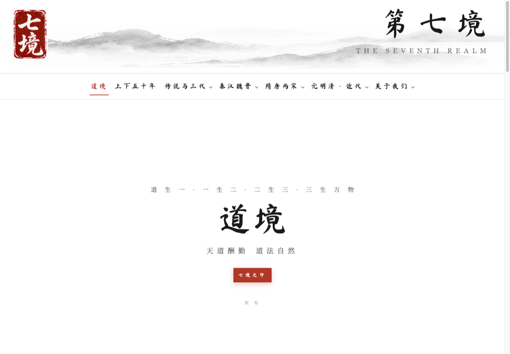
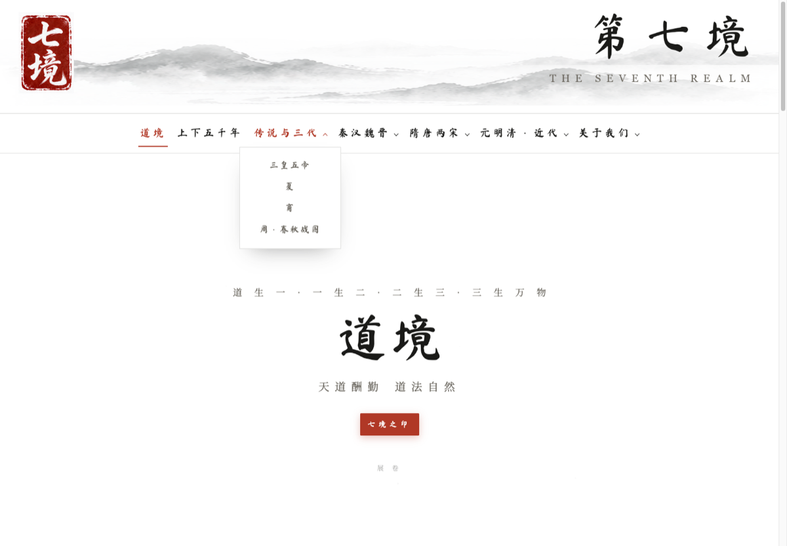
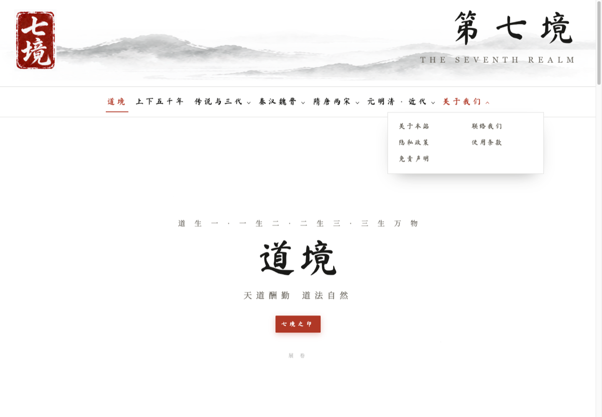

# 用 WorkBuddy 给 WordPress 做子主题：4 个文件让每个新页面自动套上你的设计（不用写 PHP）

> 适合人群：用 WordPress 区块主题（比如 Twenty Twenty-Five）做定制站点的人。
> 本文的方案、文件与排查过程，都是我与 WorkBuddy 协作做出来的——不是「AI 帮我写了个网站」的成果展示，而是**每一步怎么让它做、以及中间踩了哪些坑**的完整过程。
> 成品站点：theseventhrealm.com（纯白水墨风，收域名只作作品指认，本文不涉及任何付费与推广）

## 一、先说结果

我的站有十几个内容页 + 五份法务页 + 一个产品介绍页，**没有一页手贴过横幅、导航和页脚**。



新建页面的流程缩到三步：新建 → 在编辑器里塞一个「自定义 HTML」区块写正文 → 发布。
改导航时只改一处文件，全站几十个页面一起变。

## 二、别让它先写代码，先让它把模板层级讲清楚

我第一个提示词问的不是「帮我做个子主题」，而是：

> 我用的 Twenty Twenty-Five 区块主题，新增的「页面」到底套哪个模板？父主题的哪个文件在管这件事？给我讲清楚 WP 的模板层级，再告诉我最小改动路径。

这一步省掉了后面大量返工。**让 AI 动手之前先让它讲原理，原理讲不通的方案，写出来一定改。**

结论是 WordPress 的**模板层级**：子主题里放一份 `templates/page.html`，就会覆盖父主题同名模板，**所有「页面」类型——包括以后新建的——自动套用**。所以这一套的关键不是写多少代码，而是找对那一个文件。

## 三、它给出的四个文件（全部可直接抄）

```
my-child-theme/
├── style.css           # 头部注释写 Theme Name + Template: twentytwentyfive
├── functions.php       # 只做两件事：引入样式 + add_editor_style
├── theme.json          # 内容区限宽、白底、清掉默认间距
├── templates/page.html # 品牌横幅 + 吸附导航 + wp:post-content + 页脚
└── assets/qijing.css   # 全部设计样式，改一处全站生效
```

`page.html` 的骨架只有三块——**两个 HTML 区块夹一个正文占位**：

```html
<!-- wp:html -->
<header>品牌横幅 + 吸附导航</header>
<!-- /wp:html -->

<!-- wp:post-content {"align":"full"} /--->

<!-- wp:html -->
<footer>页脚</footer>
<!-- /wp:html -->
```

中间那行 `wp:post-content` 就是编辑器内容的落点。导航高亮没让 AI 每页手写，我用一行 JS 按 `location.pathname` 自动给当前页加 class——「写代码」和「写规则」的区别就在这里，**规则写完是一次性的，代码写完还得维护**。



## 四、坑一：模板明明改对了，首页却完全没变

这一坑耗掉我最长时间。上线后首页纹丝不动，其余页面全好了。

让 WorkBuddy 去查，它给的诊断方法很朴素却极其有效——**看页面源码里 `<body>` 的 class**：

| body class | 说明 |
|---|---|
| `page page-id-13` | 子主题模板在跑 ✅ |
| `home blog` | 没在跑，走到父主题的 home 模板去了 ❌ |

根因：模板匹配看页面类型。**首页设成「显示最新文章」时会回落到 `home.html`，`page.html` 根本不参与。**

解决：设置 → 阅读 → 首页显示改为「一个静态页面」。

> 这一条值得划重点：**AI 给的答案也可能只对一半，所以每个结论都要配一个自己能复验的判断方法。** 我让它在交方案时顺手写清楚「怎么验证」，后面几次自查都靠这个。

## 五、坑二：父主题给 body 加了 50px 根内边距

父主题 Twenty Twenty-Five 会给 `<body>` 左右各留 50px 的根内边距，我那些通栏的横幅、导航全被内缩了，两头留白像没做完。

补两条 CSS：

```css
body{padding-left:0!important;padding-right:0!important}
.brand,nav{margin-left:0!important;margin-right:0!important;max-width:none!important}
```

顺带一个通用教训：**通栏别用 `width:100vw` 硬撑**。`100vw` 包含滚动条宽度，页面一出现纵向滚动条就溢出约 8px，凭空多出一条横向滚动条。要么跟着容器自然铺满，要么用 `margin-left:calc(50% - 50vw)` 这类写法。

## 六、让它把「看不见的关系」也画出来

我自己想到的只有一个模板读取层级，AI 还补了一层**行政区划级别的类型关系图**：哪种页面走哪个模板、例外是什么。这类结构性清单自己列容易漏，**交给 AI 列再人工抽查，性价比最高**。

同样的思路也用在权限上：需要脚本远程改正文时，我用「应用密码」配一个**编辑角色**的专用账号。这个角色天然碰不到主题与插件——**不是靠自觉约束，是靠权限架构隔离**，写错脚本也炸不到全站。

（脚本调用接口前，请先看目标站点的 robots 与服务条款，顺着站点自身的规则来，不要用伪装手段绕过它自己的访问控制。）

## 七、五条踩坑清单

1. **先问原理再要代码**——原理讲不通的方案，写出来一定返工
2. **每个结论配一个可复验的判据**——比如用 `body` 的 class 判断模板有没有生效
3. **不用 `100vw` 做通栏**——滚动条会让你多一条横向滚动条
4. **注意父主题的根内边距**——看起来像你的样式写错了，其实是被上级约束了
5. **改样式只改一个入口文件**——把设计变量和样式集中在一处，迭代成本才是线性下降的

## 八、做完这一天，手上留下的是什么



回头看，真正留下来的不是那十几张页面，而是**四样可复用的东西**：一份 `page.html` 骨架、一组集中管理的设计变量、一张模板层级的结构认知图、一套「看 body class」的模板诊断法。

页面的样式会过时，这几样不会。后来我加产品介绍页、加五份法务页，一行样式都没重写——**这就是「一次性想清楚」和「每个页面贴一遍」的区别。**

## 九、什么时候该走这条路

不是所有站都需要子主题。我这边的判断是这样的：

- **只改颜色和字体** → 后台「站点编辑器」够了，别碰代码
- **要全站统一的横幅/导航/页脚** → 子主题 + `templates/page.html`，本文这条路
- **要改数据结构、加自定义字段** → 那就不该用「不写 PHP」的方案，老实做插件

---

**你被 WordPress 模板层级卡过吗？** 是首页不生效、还是被父主题样式覆盖、还是每次新建页面都要手动贴一遍？评论区聊聊，对应的排查思路我可以单独整理一篇。

---

## 发布清单（这段不要粘贴到正文）

| 项 | 值 |
|---|---|
| 版本 | v2 投稿版（2026-10-03 补强；v1 为中文字数 524、0 配图的短稿） |
| 中文字数 | ≥800（以 `prepare-post.py --post post2 --check` 输出为准） |
| 配图 | 3 张，在 `09-社区/配图/`：`post2-图1-套用模版后的页面成品.png`、`post2-图2-四个时期面板自动高亮.png`、`post2-图3-关于我们与法务页.png`（均从 03-页面/ 成品截图压缩而来） |
| 标签 | **#WorkBuddy**（必带）+ AI 办公 + 效率工具 |
| 来源 | 原创 |
| 专栏 | AI 与大数据 / 云+社区 |
| 入口 | https://cloud.tencent.com/developer → 右上角「写文章」 |
| 账号 | 必须与 WorkBuddy 同一微信 / 手机号 / QQ 登录 |
| 到账 | 发后 1–3 个工作日（等审核），别重复投稿 |
| 泄密体检 | ✅ 未公开母版源码/脚本/内部参数；未公开未做的计划；未公开绕过访问控制的做法 |

> 发布时把正文里的 `配图/post2-图N-*.png` 替换为平台上传后的图片链接。
