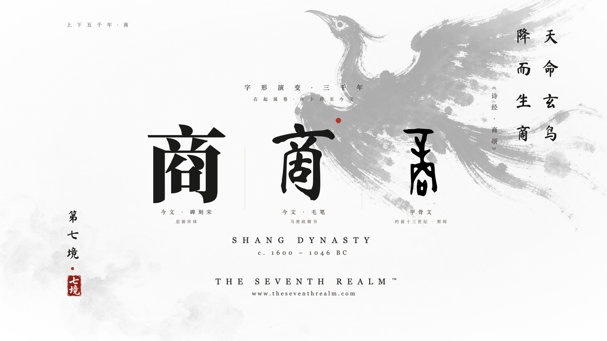
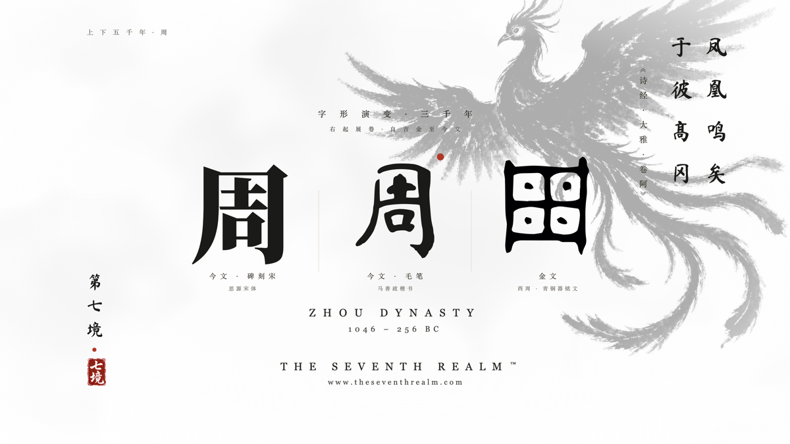
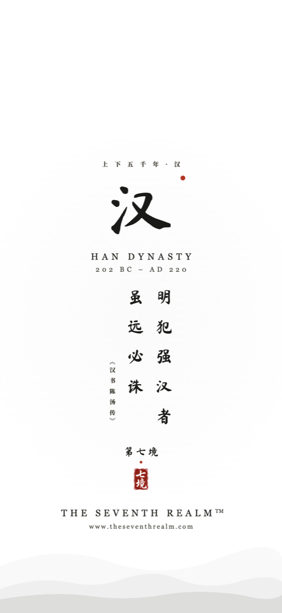
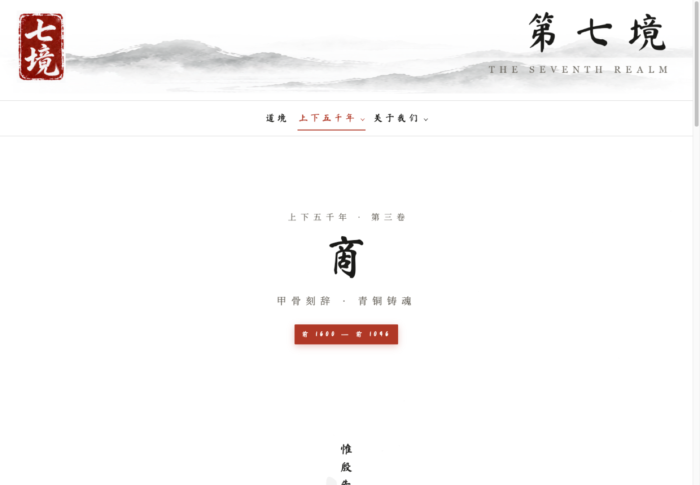

# 用 WorkBuddy 从 0 搭一条水墨壁纸生产线：16 朝代 32 张 4K 成品，全过程可复现

> 适合人群：想用 AI 做出拿得出手的数字素材（壁纸 / 模版 / 配图）的人，以及想知道「怎么把 AI 从聊天框变成生产线」的人。
> 本文全部产出由我与 WorkBuddy 协作完成，零设计基础、零美术外包，成品见 theseventhrealm.com。

## 一、先说结果

- 16 个朝代 × 桌面横版 + 手机竖版 = **32 张成品**，桌面版真 3840×2160
- 一套设计资产沉淀（毛笔字体 / 品牌印章 / 神兽底纹 / 设计变量），换数据就能出新图
- 从「想做一套壁纸」到「第一批成品能挂出去」，中间没有请设计师，也没打开过 Photoshop



## 二、关键不是让它画图，是先让它定规矩

我踩的第一个坑：上来就说「帮我画一张商朝水墨壁纸」。出图确实好看，但**第二张跟第一张不像一个系列**——字号、留白、印章位置全在漂。

正确做法是先定死一组设计变量，之后再出任何图都引用它：

```css
:root{
  --ink:#1a1a1a;         /* 墨色 */
  --cinnabar:#9e2b25;    /* 朱砂，只用于印章与点睛 */
  --paper:#ffffff;       /* 宣纸白 */
  --hero-size:470px;     /* 主字字号 */
  --texture-opacity:.34; /* 神兽底纹淡化到 34%，如水印 */
}
```

想改风格只改这一处，全套图跟着变。**这一步值得单独开一个会话做**，别和出图混在一起——混在一起它会一边定规矩一边改，最后两边都不干净。

## 三、一条流水线，五个环节

### ① 神兽底纹：生成完要让脚本验收，不要用眼睛验收

提示词的要素顺序会直接影响结果，我的固定句式是「题材 → 材质 → 构图 → 排除项」：

```
traditional Chinese ink wash painting, mystical bird,
deep black ink on pure white paper, extreme minimalism,
vast empty white space, no text no seal
```

最后的 `no text no seal` 很关键：AI 特别爱自己加字、加盖印章，一加就没法排版了。

生成完别急着用，让 WorkBuddy 写一个校验脚本，三条硬指标：四角采样背景白度、墨量占比（12% 左右构图最舒服）、神兽主体位置（必须避开中间的主字区）。不达标就重新生成。**验收交给脚本，比人眼稳定，而且不烧积分。**

### ② 甲骨文字形：一定要拿矢量，别拿位图

这一环我返工过一次：最早用搜索引擎找的位图字形，放大到 4K 全是马赛克，整张废掉。后来改成去公开的字形站点找**矢量**资源（SVG），放大多少倍都锐利。判断标准很简单——能无损拉到 4K 的才叫素材，不能的一律不用。

顺带一句法律上的提醒：**古文字本体属于公有领域，但别人站点的服务条款不是**。下载前看清授权，只用于个人学习与非商业用途，别批量抓取。

拿到矢量后，把甲骨文字形与今文放在同一张图里对照——三千年前后的同一个字彼此对视，这就是这套图的价值所在。

### ③ 毛笔字体：一定要落地到本地

用 CDN 字体有回退风险，一旦掉成楷体，气势全失。下载 TTF 后用 `@font-face` 嵌入，并在渲染前断言字体真的加载了：

```js
await document.fonts.check('470px "MaShanZheng"'); // true 才允许截图
```

### ④ 排版：用 HTML，不要用图片编辑器

绝对定位布局 + 上面那组变量。品牌印章是从 logo 图里按色相范围像素级抠出来的（朱砂红与墨色保留、其余透明），比重新画一个更统一，也永远不会变形。



### ⑤ 真 4K 导出：别信「放大」

用浏览器渲染法：按 1920×1080 布局，整体放大 2 倍导出：

```bash
agent-browser set viewport 3840 2160
# 在 HTML 里注入 html{zoom:2}
agent-browser screenshot /绝对路径/成品.png
sips -g pixelWidth -g pixelHeight 成品.png   # 必须核对
```

最后那行核对不能省：把 1080 拉大冒充 4K，骗得过自己骗不过用的人。

## 四、让它把活写成脚本，而不是每次重画

这是整条线最值钱的一步。做完第一个朝代后，我让 WorkBuddy 把版式抽成生成器：**数据（朝代名 / 神兽 / 金句 / 字形）与版式分离**，换一组数据就出一张新图。

**16 个朝代 = 16 组数据，不是 16 次重做。** 后来加手机竖版（1179×2556）、Mac 版（3840×2496），也只是多传一组尺寸参数而已。



顺带一个省积分的教训：让 AI 一张张画，积分烧得飞快；让它把脚本写好、由脚本批量跑，出图环节几乎不花积分。**能脚本化的步骤，千万别用对话做。**

## 五、踩坑清单（五条，每条都浪费过我一次返工）

1. **截图路径必须用绝对路径**——相对路径会落在浏览器守护进程的工作目录里，你会以为脚本根本没跑
2. **截图前等 5–6 秒**——字体没加载完就出图，拿到的是一张楷体废图
3. **每张成品立刻核对像素**——假 4K 砸的是自己的招牌
4. **先定变量再出图**——顺序反了，整套视觉会散成一堆好看但不成系列的图
5. **给 AI 的需求要一次说清**：目标、现有素材路径、约束、验收标准，四样缺一样就容易返工；而返工一次的积分，够脚本跑十次

## 六、做完这条线，手上留下了什么

回头看，真正留下来的不是那 32 张图，而是四样东西：**一组设计变量、一套本地字体、一枚可复用的品牌印章、一个数据驱动的出图脚本**。

图会过时，这四样不会——换一组数据就是一套新图，换一组尺寸就是一个新规格（桌面横版、手机竖版、Mac 版都是这么来的，没有重做过一次版式）。



（成品与网站：theseventhrealm.com，纯白水墨风，欢迎围观）

---

**你用 AI 做图时卡在哪一步？** 是出图不稳定、字体对不上，还是批量导出这一关？评论区聊聊，我可以把对应环节的脚本思路整理出来。

---

## 发布清单（这段不要粘贴到正文）

| 项 | 值 |
|---|---|
| 版本 | v2 投稿版（2026-10-01 补强；v1 为中文字数 571、无配图的短稿） |
| 中文字数 | 见下方自检命令输出，目标 ≥800 |
| 配图 | 4 张，在 `09-社区/配图/`：`post3-图1-商朝4K成品.png`、`post3-图2-周朝4K成品.png`、`post3-图3-手机竖版样张.png`、`post3-图4-站点成品页.png`（已压缩到便于上传的体积） |
| 标签 | **#WorkBuddy**（必带）+ AI 办公 + 效率工具 |
| 来源 | 原创 |
| 专栏 | AI 与大数据 / 云+社区 |
| 入口 | https://cloud.tencent.com/developer → 右上角「写文章」 |
| 账号 | 必须与 WorkBuddy 同一微信 / 手机号 / QQ 登录 |
| 到账 | 发后 1–3 个工作日（等审核），别重复投稿 |

> 发布时把正文里的 `配图/post3-图N-*.png` 替换为平台上传后的图片链接。
