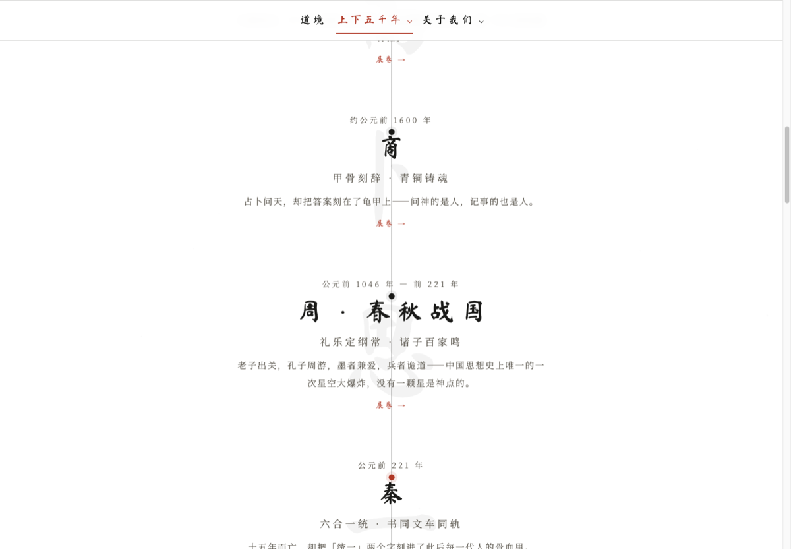

# 【征文】用 WorkBuddy 一个人量产 9.5 万字历史长卷：我是怎么把质检写成脚本的

> 这是一篇"怎么用 WorkBuddy 把一件事做完"的记录，不是成果展示。全程一个人、一台电脑，所有脚本、稿子、体检报告都是和 WorkBuddy 对话产出的。

## 一、起点：一堆撑不起来的薄页面

我手上有一个文化 IP 站点，16 个朝代页，每页约 430 字——导语加三段，只能当导读，撑不起什么。上下五千年那个长卷页更薄，全文 878 字，16 个朝代各塞了一句话。

我想要的是：16 个朝代各自成稿，合计 8 到 10 万字，够出一本书；同时长卷页要变厚。

难点不在"写"——让 AI 写几万字不难。难点在**可控**：写完以后我怎么知道它有没有写错、有没有写歪、有没有在中段偷偷换了语种。

## 二、先做骨架，不做肉

我做的第一件事，是让 WorkBuddy 帮我建一个**事件库**，而不是直接开写长文。

16 个 CSV 文件，每行四个字段：年份、事件、一句话、所属朝代。三条约束是在踩坑里补出来的：

- 年份用**负数表示公元前**（`-1046` 就是公元前 1046 年），避免"前/公元前"混写导致排序错乱；
- 一句话**不超过 30 字**，因为它将来要直接贴在长卷的时间轴上，长了会撑破版式；
- 字段内**禁用英文逗号**——CSV 按逗号切分，一个中文逗号没事，一个半角逗号就多出一列。

再让 WorkBuddy 写一个 `build-all.py`：合并 16 个文件成总表，同时体检（四列齐不齐、年份能不能转整数、一句话超没超字数）。

这一步耗时极短，收益却是立刻的：119 个结构化节点落库，时间线页当场变厚，长尾词也跟着变多。

> 值得单独说一句的取舍：**先做结构化的小数据，再做非结构化的长文。**小数据能被程序校验，能被复用到年表、滚轴、商品文案；长文只能一次性用。

## 三、给稿子定"模板"，不是定"题目"

第二步才是写长文。我没有一稿一稿地出题，而是让 WorkBuddy 先定死一个模板，16 朝共用：

金句＋出处 → 导语（≤150 字）→ 6 到 11 节正文 → 字·物·事三张卡 → 收尾 → 终句 → 引用出处 → 附：给 ops 的更新对照。

两个细节后来证明最值钱：

1. **金句沿用线上已有的锚点**，不改品牌调性，正文只做展开；
2. **每稿末尾附一张"线上页面怎么改"的对照表**——内容写完的同时，把交接动作也写清楚，后面改页面零成本。

字数目标按朝代厚度分档（4000 到 6000），写完必跑体检。

## 四、把质检变成一条命令

这是整个工程里我认为最该抄走的一步。

我让 WorkBuddy 写了一个 `count.py`，做四件事：统计每稿正文中文字数与目标差额、检查串语种字符、检查正文里残留的拉丁词、输出差额表。**每写完一稿必跑，跑不过就改。**

它拦下来的问题，靠眼睛是看不出来的。举两类：

- **串语种**：长文本生成会偶发在一段中文里混进俄语、越南语、日文假名甚至希伯来字符。你通读一遍也不会注意，正则一查就出来。
- **标题被吃掉**：我用脚本插入段落时，习惯拿小标题行当锚点做字符串替换，结果标题常被吞掉，留下孤零零的「：xxx」残行，小节编号全乱。后来改成不拿标题行当锚点，收尾必须 `grep -n "^## "` 复核结构。

另外三个小坑，也一并记在这里：CSV 带 BOM 导致首列解析成 `\ufeff年份`、`int()` 报错（改用 `utf-8-sig` 读）；同一句同时出现在正文和三张卡里，导致"锚点唯一"断言失败；bash 里 `${VAR}` 后面紧跟中文会被当成一个变量名。

**一句话总结：AI 的错误不是随机的，是可预期的。把可预期的错误写成检查脚本，才是真正的效率来源。**

## 五、一键重建，而不是手工同步

内容改了，年表、书籍、页面都得跟着变——这件事如果靠手工同步，第三次一定出错。

所以第三阶段我让 WorkBuddy 写了 `build-book.py`：**年表由事件库生成，各章由朝代稿转换，引用索引自动汇总**，改任何一稿重跑脚本即可，脚本幂等，跑两次无变化。生成物一律不手改。

结果：卷首、年表（119 节点）、正文 16 章、引用索引（221 条出处 / 191 种典籍）、后记，合成全书 **95,502 中文字**。

长卷页也用同样思路回填：写了个 `build-scroll.py`，把 119 个节点按朝代块塞回页面，一次生成片段与整页两个文件，避免两边漂移。页面从 **878 字涨到 4,626 字**，且每朝节点数与事件库逐项对得上。

## 六、三条可以立刻抄走的经验

1. **先建小数据，再写长文。**能被程序校验的东西先落地，长文才有地方挂靠。
2. **模板比题目重要。**题目是消耗品，模板是资产——16 稿共用一套模板，才有可比性和可验收性。
3. **质检必须是命令，不应该是"我再读一遍"。**人读不出的错误（串语种、结构错位）才是真正会漏到线上的错误；凡是能被写成脚本的检查，都该写成脚本。

## 七、留给读者的一个问题

我至今没解决的一个问题是**事实校对的最后一公里**：脚本能查字数、能查语种、能查结构，但查不了"这句话引的书里到底有没有这个篇目"。我在录典籍原文时，靠人工查出过六处"引错书"——《史记·太史公自序》里的"究天人之际"其实出自《报任安书》，《隋书》里根本没有李春传。

你们在用 AI 做长内容时，这一步是怎么兜的？有什么能自动化的办法吗？欢迎在评论区聊聊。

---

## 发布清单

| 项 | 值 |
|---|---|
| 标题 | 【征文】用 WorkBuddy 一个人量产 9.5 万字历史长卷：我是怎么把质检写成脚本的 |
| 板块 | **【实用文章】**（本期征文硬性要求，选错视为非参赛作品） |
| 标签 | #WorkBuddy / AI 办公 / 效率工具 |
| 来源 | 原创 |
| 专栏 | AI 与大数据 / 云+社区 |
| 配图 | 4 张（`09-社区/配图/post4-图1~图4`，发布时手动上传替换占位链接） |
| 征文窗口 | 《WorkBuddy 频道首届征文活动》2026-10-12 → 2026-11-02，本期**无需另填问卷** |
| 状态 | **待批**——等你一句话批准才发；批准后在 https://cloud.tencent.com/developer 右上角「写文章」手动发布 |
