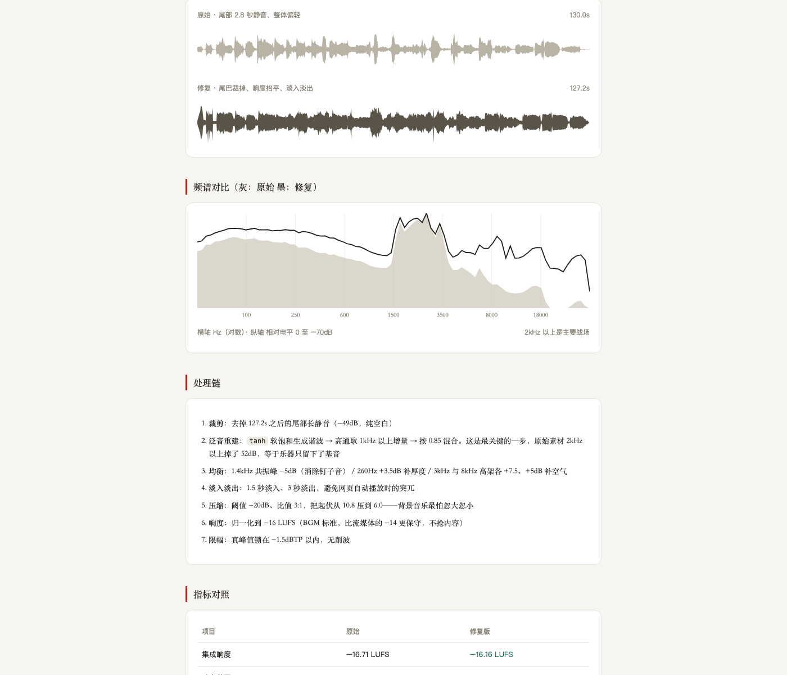
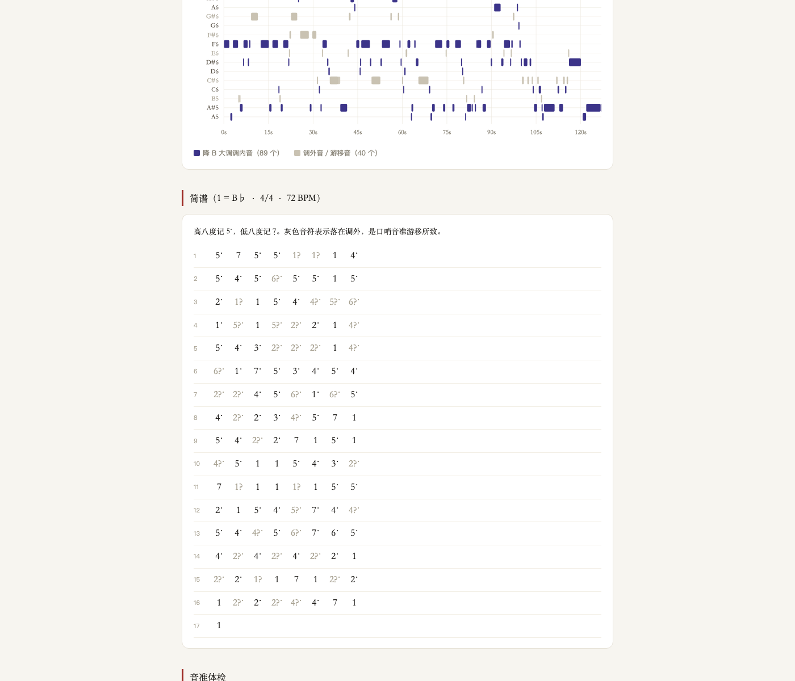
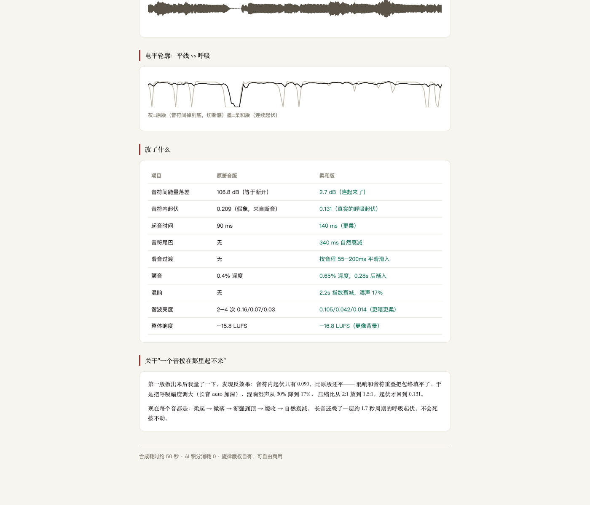

# 【征文】用 WorkBuddy 把一段口哨变成 129 个音符的简谱：整个过程 0 积分 0 元

> 这是一篇"怎么用 WorkBuddy 把一件事做完"的记录，不是成果展示。
> 全程没有用过任何 AI 音乐生成平台，也没有花过一分钱——WorkBuddy 在这里干的活是**写处理音频的代码**，不是作曲。



## 一、起点：一段不能直接用的录音

我要给一个文化 IP 做主题背景音乐。起点是我自己用手机语音备忘录录的 **2 分 10 秒口哨**——想着口哨干净、辨识度高，拿来当品牌音准应该挺合适。

录完听了一遍，问题比我想的严重：整体发闷，音量忽大忽小，结尾还拖着一截空白。直接挂到网页上会盖过正文内容。

我一开始的判断是"素材不够好，去找个 AI 音乐模型生成一首"。

于是我去比了一圈工具的价：免费版不给商用授权，付费版一个月五六十到七十多，中文的还挑。为了一段两分钟的音乐要先交一年的会员费——**而且生成出来的是别人的曲子，不是我的口哨。**

然后我意识到因果搞反了。

## 二、关键转折：缺的不是生成权，是处理权

素材是我自己吹的，**创作权本来就在我手里**。

我不需要为"生成权"付一分钱，我需要付的只是"后期处理"的钱——而后期处理这件事，用开源命令行工具就能做完，一分钱不花。

> 素材已有时，AI 音乐平台的订阅是纯浪费。它值钱的是"你没素材时凭空造一段"的能力，这个能力对我一文不值。

所以路线整个反过来：**不是让 AI 作曲，是让 WorkBuddy 帮我写处理这段录音的代码。**

这也是我写这篇的原因——如果你手上已经有素材，这套做法是能直接复用的。

## 三、先体检，别凭耳朵猜

拿到一段"听着不对"的录音，第一件事不是动手改，是先跑数据，搞清楚到底坏在哪。

跑三件事：响度、静音段、波形频谱。WorkBuddy 直接把体检脚本写了出来，输出结果很具体：

- 整体响度 **−16.71 LUFS**，勉强能用
- 动态范围 **LRA 10.80**，偏大——这就是"忽大忽小"的来源
- **2–4kHz 只有 −52.8 dB，4–8kHz 只有 −64.0 dB**，这两个频段基本是空的
- 有效带宽 **8,229 Hz**，正常应该到 16k 以上
- 主频常年钉在 1420–1460Hz，自相关接近 1.00

最后一条是关键。**自相关接近 1.00，说明信号几乎是纯正弦波**——这是箫、埙、长笛这类乐器的特征，泛音本来就少。再补一刀：正常录音在 2–8kHz 应该有相当能量，掉到 −50dB 以下，基本就是编码带宽被砍了。

结论：**高频不是"不够亮"，是"根本不存在"。**

## 四、最反直觉的一步：别用 EQ 救它

大部分人的第一反应是开 EQ 把 2–8kHz 拉起来。

**这是错的。**那里压根没有信号，拉 EQ 只是在放大噪声——听起来更刺耳，没有任何改善。

真正有用的做法是**谐波激励**：用软饱和让波形自己长出新的谐波成分，再把多出来的那部分高通取出来，混回原信号。WorkBuddy 给的代码核心就三行：

```python
drive = 1.9
sat  = np.tanh(x * drive) / np.tanh(drive)   # 软饱和，产生奇次谐波
harm = sat - x                                # 只取"多出来的"谐波部分
harm = hp(harm, sr, 1000)                     # 高通两次，只留 1kHz 以上
x    = x + harm * 0.85                        # 混合回去
```

效果实测：

| 频段 | 处理前 | 处理后 |
|---|---|---|
| 2–4kHz | −52.8 dB | **−36.6 dB**（+16 dB） |
| 4–8kHz | −64.0 dB | **−37.1 dB**（+27 dB） |
| 8–14kHz | — | **+32 dB** |
| 有效带宽 | 8,229 Hz | **18,691 Hz** |

几行代码换 10kHz 带宽，成本 0。



## 五、口哨的音高，自相关会骗你

这一段是我花时间最多的地方。

口哨的波形几乎是纯正弦，所以自相关算基频特别"准"——第一次分析给出 560–723Hz，看起来很合理。

**但频谱上 500–750Hz 几乎没有能量**（−46dB），真正的峰值在 1250–1500Hz。

**723Hz 是自相关把周期算长了一倍的误判。真实基频在 1400Hz 附近。**

教训：**测音高不能只信自相关**。对纯音乐器，FFT 峰值 + 抛物线插值更可靠，判断依据是"那个频率上到底有没有能量"。我当时自相关的搜索上限只设到 800Hz，正好把真基频排除在外了。

改成逐帧 FFT + 抛物线插值之后，流程是：

- 逐帧 4096 点 FFT（48kHz，分辨率约 12Hz），限 400–3000Hz
- 峰值突出度 + RMS 双阈值，滤掉吹气噪声
- 5 点中值滤波平滑音高轨迹
- 连续 0.5 半音内算同一个音，间隔 >0.12s 断开
- <0.16s 且相差 <2 半音的碎片并入前音（口哨滑音会切出大量碎片）
- 减掉系统性音分偏差后量化到 MIDI 整数音高

结果：**135 → 129 个音符**，音域 A5–A♯6（13 个半音），平均绝对音准偏差 **24.3 音分**，最大 49.5 音分。

**怎么判断调性？**看三件事：结束音落在哪（本例 A♯5 持续 4.8 秒，明确的主音收束）、哪些音出现最多（F 与 A♯ 各 26 次，纯四度的主-属关系）、音阶能不能套进去（配上 D♯=4 级、C=2 级、D=3 级，**降 B 大调成立**）。调内音占 89/129，剩下的调外音集中在 C♯/E/B/G♯，基本是口哨音准游移的产物。

## 六、把 129 个音符写成简谱，再反过来合成

既然音符已经量化到标准音高，就能反向合成出可听的版本。WorkBuddy 写的加法合成是这样：

```python
tone = sin(ph) + 0.16*sin(2ph) + 0.07*sin(3ph) + 0.03*sin(4ph)   # 基频+少量谐波
vib  = 1 + 0.004*sin(2π*5.1*t) * ramp(t, 0.25s)                   # 延迟起振的颤音
env  = ADSR(a=0.09, d=0.12, s=0.82, r=0.30)                       # 包络
```

第一版出来之后，我发现了一个反直觉的取舍。

原版每个音是孤立的，音符之间能量落差 **106.8 dB**——听感是"一个音一个点"，没有连成句子。加了滑音、气息包络、混响之后落差降到 **2.7 dB**，音符连绵了。

**但这版太黏了。**音符内的起伏从 0.209 掉到 0.131——因为混响湿声 30% 加上音符重叠，把包络填平了，听上去像一块棉花。

> **"连绵"和"有起伏"是两股相反的力。**混响和音符重叠会吃掉动态，必须给它留出来。

最后把湿声降到 17%、压缩从 2:1 放到 1.5:1、呼吸幅度调大，起音时间放到 140ms，才回到 0.131，同时保住 2.2s 指数衰减的混响。



## 七、交付与真账本

| 格式 | 用途 |
|---|---|
| WAV 48kHz / 24bit | 母版存档，以后再改从这里出发 |
| MP3 320kbps | 网页 / 通用 |
| M4A AAC 256k | 苹果生态、视频剪辑 |

| 项目 | 花费 |
|---|---|
| AI 积分 | **0** |
| 工具费用 | **0 元**（ffmpeg / numpy / scipy 全开源） |
| 时间 | 约 40 秒（含分析与导出三种格式） |
| 商用授权 | **0 元**（素材自有 + 本地处理，无平台条款束缚） |

工具链就三样，全免费：

```bash
python3 -m venv ~/env
pip install imageio-ffmpeg numpy scipy
python -c "import imageio_ffmpeg; print(imageio_ffmpeg.get_ffmpeg_exe())"
```

`imageio-ffmpeg` 自带静态编译的 ffmpeg 二进制，不用装 Homebrew，零污染。

## 八、三条可以立刻抄走的经验

1. **先判断自己缺的是"生成权"还是"处理权"。**已有素材时，生成式订阅是纯浪费。
2. **缺失的频段不能用 EQ 救。**那里没有信号，EQ 只会放大噪声；用谐波激励让波形自己长出泛音。
3. **纯音乐器的音高不能只信自相关。**FFT 峰值 + 抛物线插值 + "那个频率上有没有能量"，三重校验。

## 九、留给读者的一个问题

我在这个项目里最花时间的不是修音频，是**判断音高**。

一个 24 音分的偏差听起来还是"在调上"，但一个把基频算错一倍的判断，会让你后面所有的工作都建在错误的前提上——而且这种错误不会报错，只会安静地给出错误结果。

你们在用 AI 处理素材时，有没有遇到过"它没报错，但结果是错的"这种情况？有什么校验手段是你们在用的？欢迎在评论区聊聊。

---

## 发布清单

| 项 | 值 |
|---|---|
| 标题 | 【征文】用 WorkBuddy 把一段口哨变成 129 个音符的简谱：整个过程 0 积分 0 元 |
| 板块 | **【实用文章】** |
| 标签 | #WorkBuddy / AI 办公 / 效率工具 |
| 来源 | 原创 |
| 专栏 | AI 与大数据 / 云+社区 |
| 配图 | 3 张（`09-社区/配图/post5-图1~图3`，发布时手动上传替换占位链接） |
| 状态 | **待批**——等你一句话批准才发；批准后在 https://cloud.tencent.com/developer 右上角「写文章」手动发布 |
