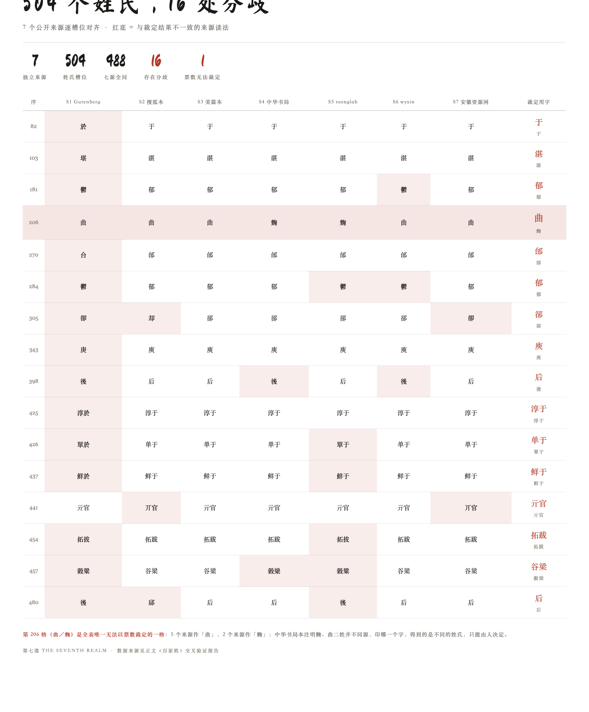
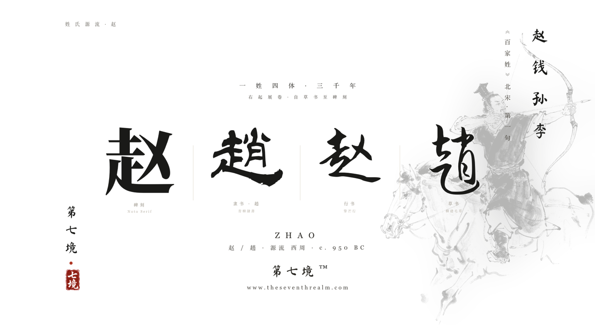
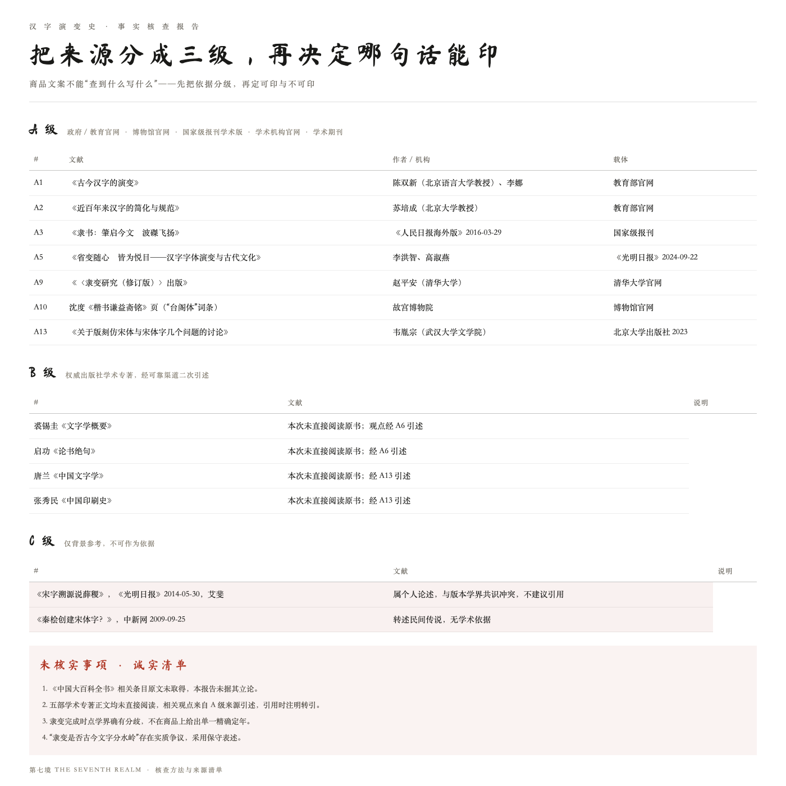
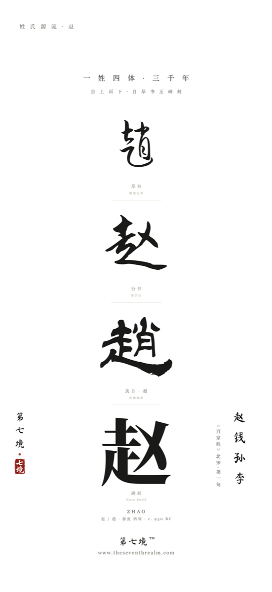

# 【征文】用 WorkBuddy 给 504 个姓氏做交叉验证：16 处分歧怎么裁，以及 1 处裁不了

> 这是一篇"怎么用 WorkBuddy 把一件事做完"的记录，不是成果展示。
> 事情很小：给 504 个汉字找出它们在古籍里的正确写法。但它是我做过的、最能说明"AI 该被信任到什么程度"的一道题。

## 一、起点：一个看起来不需要 AI 的任务

我在做一个汉字书法主题的壁纸系列，其中一条线是《百家姓》——504 个姓氏，每个姓一个字，配上四种书体的写法。

《百家姓》是北宋的蒙学韵文，公有领域，全文 568 字（末尾一句「百家姓终」）。**文本是确定的，所以这个任务看起来不需要 AI。**

但真正动手时我发现了问题：**网上一搜《百家姓》，出来七八个版本，每个版本都自称"完整"。**

这不是"标题党"式的差异，而是同一段文本里有具体的字不一样：

- 有的版本第 82 位是「於」，有的是「于」——而「于」和「於」在《百家姓》里**是两个不同的姓**；
- 有的版本第 206 位作「麴」，有的作「曲」；
- 「郁」有版本写作「鬱」；「后」和「後」有版本混用；「拓跋」有版本写作「拓拔」；「谷梁」有版本写作「穀梁」。

随便挑一个版本用？**不行。** 这不是排版风格差异，是**字形错误**——印在姓氏壁纸上的字如果是错的，对那个姓的人就是直接的冒犯。

所以任务的性质变了：**不是"找到《百家姓》"，而是"判定这 504 个字里，哪些写法是对的"。**

这就不是查一下能解决的了。我需要一份**可复核的、有证据链的裁定表**，而且每一个裁定都要能回答"你凭什么这么判"。

## 二、先定义"对齐"，否则后面全是错的

这一步是整件事里最容易做错、也最容易被跳过的地方。

我先把任务拆成三段：

**第一步，确定槽位。** 《百家姓》有 444 个单姓、60 个复姓，共 504 个槽位、564 个姓名字（复姓占两格）。切分依据不能靠"看起来像复姓"，我用了一份提供单姓/复姓键的公开列表来定界——否则「第五言福」这种尾巴会被切错。

**第二步，只做可逆的繁简归一。** 这一步最容易出问题。

大多数人会想：把繁简统一了再比，不就快了？**但繁简归一正好会把我最需要看见的差异抹掉。**

「麴」和「曲」不是繁简关系，是两个不同的姓；「於」和「于」也不是繁简关系，是两个姓；「郤」和「却」更不是。如果我把它们"规范化"成同一个东西，比对结果会显示"七源全同"——**而实际上有 16 格是错的。**

所以我定了一条规则：**归一化只允许做可逆的繁简对应，并且刻意保留所有可能的实质差异**，让它们以"分歧"的身份暴露出来，而不是被平均掉。

**第三步，声明来源独立性。** 这一步是查完才发现的，也是我最庆幸做了的一步。

我一共找了 7 个来源，看起来是 7 票。但核对之后发现：**其中两个（两个自媒体转载）可能同源，另外两个（两个 npm 包）也同源。** 去掉可能同源的，剩下的是 3 个互相独立的传统。

如果不查这一层，我就会拿"5 比 2"当结论——而这个"5"里可能有 3 票是同一个来源的复读。**票数是幻觉，独立性才是证据。**

## 三、结果：488 格全同，16 格分歧，1 格无解

跑完之后，结论比我预期的干净：

**504 个槽位里，488 格在 6 个完整来源上逐字一致。** 剩下 16 格有分歧。

这 16 格里，**15 格可以直接裁定**，原因分三类：

1. **明显的转录错误**：第 82 格有一版把「于」写成「於」；第 103 格有一版把「湛」写成「堪」；第 270 格把「邰」写成「台」；第 343 格把「庾」写成「庚」。这类不用投票——**一个来源跟其余六个不一致，且它错得没有道理**。
2. **别字与正字之争**：第 181 格、第 284 格有版本写「鬱」，但「鬱」是"草木茂盛"义的独立字，郁姓的繁体仍作「郁」；第 305 格的「郤」是正字，「卻/却」是另一个字；第 441 格的「亓」是正字，「丌」是异体。
3. **整姓名的连锁错误**：第 425、426、437 格是「淳于」「单于」「鲜于」三个复姓，有版本把里面的「于」一并写成「於」——**一个错字会顺着整串传下去**，这也是为什么必须按槽位比、而不是整段做字符串 diff。

**剩下 1 格，票数裁不了。**

第 206 格，候选是「曲」和「麴」。5 个来源作「曲」，2 个来源作「麴」。

按票数，5:2，该定「曲」对不对？

**不对。** 因为中华书局本明确注明：**麴、曲是二姓并不同源**，不是繁简关系。所以这不是"哪个来源抄错了"，而是**两个都对的姓，只是碰巧排在同一格**。印「曲」还是印「麴」，得到的是两个不同的姓氏。

这一格我在报告里单独列为"需人工决策"，写清两个候选、各自的支持来源、以及二选一的后果——**然后交给人决定，不由程序决定。**

> 我的判断是：程序能负责"把差异摆出来、说清楚每一种读法的来源和后果"，但**不该负责"在两个都成立的选择里替人挑一个"**。最后那一步是判断，不是计算。

## 四、这套方法不止用在姓氏上

做完《百家姓》之后，我把同一套流程搬到了另一个项目上：**汉字演变史的科普文案。**

这个项目的风险不一样。姓氏错一个字，是一个人的字被印错；演变史错一句话，是几千万人看到一条假知识。

所以这里我加了一层：**来源分级。**

我把所有依据分成三级：

- **A 级**——政府与教育官网、博物馆官网、国家级报刊学术版、学术机构官网、学术期刊；
- **B 级**——权威出版社学术专著，但**本次未直接阅读原书**，观点来自 A 级来源的引述，引用时注明"转引"；
- **C 级**——仅作背景参考，**不可作为依据**。比如网上流传的"秦桧创宋体""薛稷创宋体"，我找到的原始出处是《光明日报》上一篇个人论述，与版本学界共识冲突——**这不是"不知道"，这是"查到了，而且判定为不可用"**。

分级之后，产出了一份"**可印句子**"清单和一份"**不要印**"清单。前者是可以直接印在商品上的表述，后者是明确标注"不要印"的表达。

比如宋体这一条，网络上流传最广的写法是"宋体字是宋朝人创的"。核完之后的可印表述是：

> **宋体字形成于明代嘉靖晚期至万历年间，脱胎于宋代雕版刻本的楷书字样；它是印刷字体，而非宋代通行的书体。**

同一份报告最后还有一节叫"**未核实事项 · 诚实清单**"，写明四件我没能确认的事，包括《某百科》相关条目原文未取得所以没拿来立论、五部学术专著正文均未直接阅读、隶变完成时点学界确有分歧所以不给单一精确定年。

**把"我没能确认的"明确列出来，比把话写圆更重要。** 一句被标注了来源的话，读者可以顺着去查；一句自信的错话，读者只会记住。

## 五、还有一个副产品：引错了书

在做这套核查的过程中，我顺手录了一批典籍原文。结果发现了一类比错字更严重的问题——**引错了书**。

不是抄错字，是**出处张冠李戴**。举几个：

- 「究天人之际，通古今之变，成一家之言」——流传中多系于《史记·太史公自序》，**实际出自《报任安书》**（《汉书·司马迁传》引）；
- 隋代赵州桥匠人李春——常被系于《隋书·李春传》，**《隋书》里没有这个传**，李春之名实出唐代张嘉贞《石桥铭序》；
- 张仲景——常被系于《后汉书·张仲景传》，**《后汉书》里也没有这个传**，应据《伤寒杂病论》自序；
- 「三十老明经，五十少进士」——常被系于《新唐书·选举志》，**实际出自《唐摭言》**。

**这几处不是笔误，是引用关系的错误。** 一句名句被系到错误的书上，读者顺着书去查却查不到，这比字写错更伤人。

我把它们全部回改了，并且给整个引用库加了一条体检：**凡"某书有某传/某志记某事"的引用，录文前必须先确认那本书里到底有没有这个传、这篇志。**

## 六、真账本

这一篇全程：

- **0 积分**（没有调用任何图像或视频生成模型）；
- **1 个 Python 脚本**（做槽位切分、归一化、逐格比对、生成裁定表与报告）；
- **7 个公开来源**（全部可点开核对，报告里逐条列了链接与来源级别）；
- **两处人工决策**（第 206 格的「曲/麴」，以及分级里"哪些来源算独立"）。

最花时间的不是写脚本，是**判断两个来源是不是同源**。脚本比对只要几秒钟，"这两个自媒体是不是同一家"这件事，我查了很久。

## 七、如果你也在做类似的事

三条可以立刻抄走的：

1. **先定义对齐规则，再动手。** 我最初差点用"繁简归一"做归一化，那一步会把 16 处错误抹成 0 处。**归一化的规则里，每一条"允许抹平的差异"都要先问一句：它是不是我想找的东西。**
2. **票数不等于证据，独立性才是。** 7 个来源可能只有 3 个传统。先查同源，再数票。
3. **把"无法裁定"设计成一种正常输出。** 程序输出三种状态——一致、可裁定、**需人工决策**——比强行给出一个答案要诚实得多，也更有用。

最后是那格裁不了的字。

它就明明白白躺在报告里，编号 206，标着"decision_required"，写清楚两个候选和各自的出处。**不是所有问题都有答案，但每个问题都该有交代。**

---

## 发布清单

| 项 | 值 |
|---|---|
| 标题 | 【征文】用 WorkBuddy 给 504 个姓氏做交叉验证：16 处分歧怎么裁，以及 1 处裁不了 |
| 板块 | **【实用文章】** |
| 标签 | #WorkBuddy / AI 办公 / 效率工具 |
| 来源 | 原创 |
| 专栏 | AI 与大数据 / 云+社区 |
| 配图 | 4 张（`09-社区/配图/post6-图1~图4`，发布时手动上传替换占位链接） |
| 状态 | **待批**——等你一句话批准才发；批准后在 https://cloud.tencent.com/developer 右上角「写文章」手动发布 |
